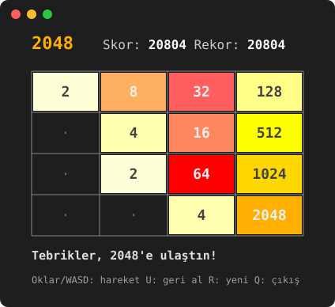

# Terminal 2048


Klasik **2048** bulmaca oyununun terminalde oynanan, renkli bir C++ sürümü. Windows, Linux ve macOS'ta çalışır.

<p align="center">
  
</p>

## Özellikler

- Renkli taşlar ve çerçeveli oyun tahtası
- Ok tuşları veya WASD ile kontrol (Enter'a basmaya gerek yok)
- Son hamleyi geri alma
- Rekor skorun dosyaya kaydedilmesi
- Oyun kurallarını kontrol eden birim testleri
- GitHub Actions ile her yüklemede Windows, Linux ve macOS'ta otomatik derleme ve test

## Nasıl oynanır?

Taşları kaydırarak aynı sayıları birleştir ve **2048** taşına ulaşmaya çalış. Her hamleden sonra boş bir yere yeni bir taş (2 veya 4) gelir. Hamle kalmadığında oyun biter.

| Tuş | İşlev |
| --- | --- |
| Ok tuşları / W A S D | Taşları kaydır |
| U | Son hamleyi geri al |
| R | Yeni oyun başlat |
| Q | Çıkış |

## Derleme ve çalıştırma

**g++ ile** (Windows'ta MinGW, Linux veya macOS):

```bash
g++ -std=c++17 -Iinclude src/*.cpp -o 2048
./2048
```

**CMake ile:**

```bash
cmake -B build
cmake --build build
./build/2048          # Windows: build\Debug\2048.exe
```

Testleri çalıştırmak için:

```bash
ctest --test-dir build --output-on-failure
```

> Windows'ta renkler için Windows Terminal veya Windows 10/11'in yeni konsolu önerilir.

## Proje yapısı

```
include/
  Board.hpp       Oyun kuralları (kaydırma, birleştirme, kazanma/kaybetme)
  Game.hpp        Oyun döngüsü, ekran çizimi, rekor kaydı
  Terminal.hpp    Windows ve Linux/macOS terminal farklarını gizleyen katman
src/
  Board.cpp, Game.cpp, Terminal.cpp, main.cpp
tests/
  test_board.cpp  Oyun kuralları için birim testleri
```

Oyun mantığı (`Board`) ekran ve klavyeden tamamen ayrıdır. Bu sayede kurallar terminal olmadan test edilebilir.

## Nasıl çalışıyor?

Dört yönün hepsi aynı fonksiyonla çözülür: her satır veya sütun, kayma yönüne göre okunup "sola kaydırma" problemine çevrilir. `slideRow` boşlukları atlayarak taşları sola toplar. Her taş bir hamlede en fazla bir kez birleşir, bu yüzden `[2, 2, 2, 2]` satırı `[4, 4, 0, 0]` olur, `[8, 0, 0, 0]` olmaz.

## Geliştirici

**Yusuf Karatepe**, Bilgisayar Mühendisliği öğrencisi
[LinkedIn](https://www.linkedin.com/in/yusuf-karatepe-0720923a1/) · [GitHub](https://github.com/ysufkaratepe)
